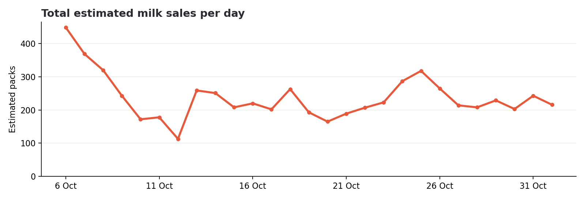
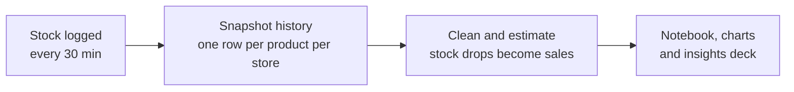

# Inside the milk aisle: quick-commerce demand from listed stock counts

Quick-commerce platforms don't publish sales, but they do show live stock. I logged every milk product every 30 minutes for one Bengaluru address, then estimated demand, price mix, availability and stockout behaviour from the changes in stock.

**[Read the one-page summary](SUMMARY.md)** · **[Open the analysis in Colab](https://colab.research.google.com/github/anagha971/milk-quick-commerce-analysis/blob/main/notebooks/milk_category_analysis.ipynb)** · **[Read the insights deck](docs/insights_deck.pdf)** · **[Full method](docs/methodology.md)**

## What I found

105 products from 22 brands across 3 dark stores serving HSR Layout, 6 October–1 November 2026 (27 full days). Sales are estimates at listed prices.

| Question | Finding |
|---|---|
| How big is the aisle? | About 6,407 packs and ₹4.02 lakh of sales value, or 238 packs a day |
| Who leads? | Amul leads packs (22%), but Provilac leads sales value (29%) |
| Does premium matter? | Milk above ₹150/L is 17% of packs but 30% of value |
| How big are protein drinks? | 24% of packs and 40% of value |
| Which pack wins? | 500 ml is 53% of packs |
| When do people buy? | The 9 am hour is the peak. Weekends run about 16% above weekdays, but there's no reliable weekly cycle yet |
| What sells fastest when available? | Provilac Cacao, at about 26 packs per sellable day against 15.6 for Amul Taaza, the top seller by total packs. This rests on about 9 sellable days, so it's indicative |
| Is it in stock? | 80% of listings (87% weighted by sales), falling to 71% at 9 pm before restocking |
| What do stockouts cost? | About 15% of demand (₹79K) potentially unmet, as an upper-bound style estimate |
| Do shoppers switch? | When Akshayakalpa Cow (Pasteurized) is out, Amul Moti Toned sells 107% more (90% interval +32% to +275%), the strongest of 14 product pairs that pass every test; an association, not proof of switching |

## What this means for a category team

These come from one address over 27 days, so each is worth testing before any wider rollout.

- **Suggest a substitute when a bestseller is out:** when Akshayakalpa Cow (Pasteurized) 500 ml is out, Amul Moti Toned 450 ml sells 107% more than usual, the pair with the strongest evidence.
- **Protect protein and Amul Taaza:** Provilac 50g Protein has the most value potentially missed (₹6,465), and Amul Taaza 500 ml the most packs (145).
- **Judge range on value as well as packs:** products above ₹150/L earn 30% of value on 17% of packs, and Provilac earns 29% of value on 14% of packs.

## How it works

**Estimating sales:** packs sold = the fall in stock for the same product at the same store between two snapshots. Rises are restocks and never count. Four artifacts are removed, and together they account for 4,091 packs that would otherwise inflate sales by about 64%:

| Artifact | How it shows up | Packs removed |
|---|---|---|
| Morning reset | Between 4 and 6 am, many products at one store landing on one value | 3,455 |
| Late reset | Later in the day, 2+ products at one store each falling 5+ units to exactly 12 (only on 1 November) | 178 |
| Closing adjustment | One store's stock falling across many products at 23:00–23:30 | 408 |
| One-off correction | One product falling 30+ units in a half-hour | 50 |

**Data health:** 1,294 snapshots at a steady 30-minute gap (two one-hour gaps), with no duplicates or missing values. 1,117 are complete; the 177 partial ones are excluded from availability, and any interval with a missing product is skipped for sales.

## Limits

- Sales are inferred, not reported. Drops may include write-offs or corrections that weren't filtered.
- Stock pinned at 12 after the morning reset probably hides some morning sales, so totals are conservative.
- One store was often hidden from 9 October, which affects the daily trend and Provilac's share.
- One address, one category and 27 days. The stores also serve other areas.
- Thousands of stockout comparisons were tested, so the notebook reports a false-discovery check, and many product-level results could still be chance.

## Repository

| Path | What it holds |
|---|---|
| `SUMMARY.md` | One page: findings, recommendations and limits |
| `notebooks/milk_category_analysis.ipynb` | The full analysis, step by step: data health, market distribution, pricing, sales, inventory, availability, and brand and product substitution |
| `analysis/` | The scripts behind the insights deck and the product and segment tables |
| `results/` | Sales by product, price segments and all brand and product substitution pairs |
| `charts/` | Charts from the notebook |
| `docs/` | Full method and insights deck |

Everything here covers 6 October–1 November 2026.

The platform name, raw snapshots and collection code are kept private, so this repository holds the analysis and its results.

## How this was built

I'm a marketer who uses data to make decisions. I built this analysis with AI assistance (Claude and ChatGPT): I set the questions, judged the data and made the method calls, such as spotting artifacts and deciding what counts as a sale.
