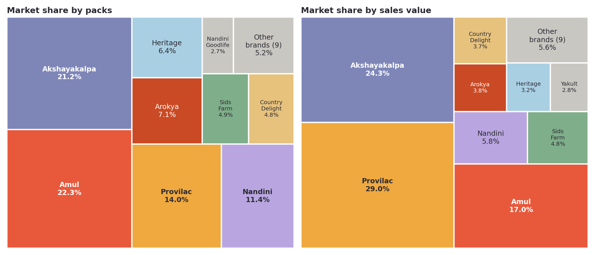
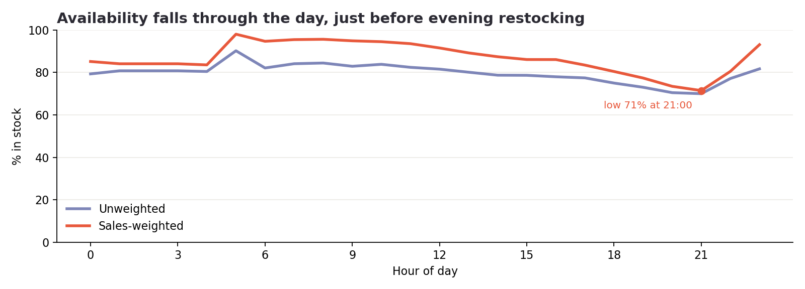

# Summary: inside the milk aisle

**Milk looks like a volume category, but the money and the risk sit elsewhere.** Everyday toned milk fills the basket, protein drinks earn a disproportionate share of value, and availability falls just as evening demand arrives.

[Open the full analysis in Colab](https://colab.research.google.com/github/anagha971/milk-quick-commerce-analysis/blob/main/notebooks/milk_category_analysis.ipynb) · [Back to the repository](README.md)

## The question

Quick-commerce platforms don't publish sales, so how can a category team read a competitor's aisle? I logged every milk product every 30 minutes for one Bengaluru address, and treated each fall in stock as estimated sales.

| Scope | |
|---|---|
| Window | 6 October–1 November 2026, 27 full days |
| Coverage | 3 dark stores, 105 products, 22 brands, 1,294 snapshots |
| Estimated sales | 6,407 packs and ₹4.02 lakh, or 238 packs and ₹14,927 a day |
| Cleaning | 4,091 packs of stock corrections removed, because they weren't orders |

## What I found

### 1. The pack leader isn't the value leader
Amul leads packs at 22%. Provilac leads sales value at 29%, on only 14% of packs, because it earns about ₹130 a pack against ₹63 for the category.

### 2. Premium earns more than its volume suggests
Milk above ₹150/L is 17% of packs but 30% of value. Protein drinks are 24% of packs and 40% of value. Even so, 500 ml remains the default purchase, at 53% of packs.

### 3. Demand follows the clock more than the calendar
Sales peak in the 9 am hour. Weekends run about 16% above weekdays, mostly before noon, but there's no reliable weekly cycle yet: the same weekday only weakly repeats from one week to the next.

### 4. Totals can hide real demand
Provilac takes the top three places on packs per sellable day. Provilac Cacao sold about 26, against 15.6 for Amul Taaza, the top seller by total packs. Provilac's total looks smaller because the store selling it was often hidden from this address. This rests on only about 9 sellable days, so it's indicative.

### 5. About 1 in 5 listings is unavailable, and evenings are worst
79.8% of listings were in stock. Weighted by sales, availability falls from about 95% in the morning to 71% at 9 pm, just before 60% of restocks arrive between 9 and 11 pm.

### 6. Stockouts may be costing about ₹2,934 a day
A model of usual sales during out-of-stock periods suggests 1,158 packs and ₹79,087 potentially missed, or 15.3% of demand. This is an upper-bound style estimate, because some shoppers would have substituted or waited.

### 7. When a product runs out, substitutes sell more
Out of 2,585 product pairs tested, 14 pass every check. The strongest: when Akshayakalpa Cow (Pasteurized) 500 ml is out, Amul Moti Toned 450 ml sells 107% more than usual (90% interval +32% to +275%). The rest are tentative and could still be chance, so I treat them as leads to test.

Brand-level substitution is weaker evidence but three results passed every test too:

| Brand short | Brand that gains | Lift | 90% interval |
|---|---|---|---|
| Provilac | Arokya | +50% | +10% to +103% |
| Akshayakalpa | Arokya | +89% | +34% to +181% |
| Amul | Heritage | +116% | +33% to +293% |

## What I'd recommend to a category team

These are recommendations from one address over 27 days, so each is worth testing before any wider rollout.

1. **Suggest a substitute when a bestseller is out.** When Akshayakalpa Cow (Pasteurized) 500 ml is out, Amul Moti Toned 450 ml sells 107% more than usual, the pair with the strongest evidence.
2. **Protect protein and Amul Taaza.** Provilac 50g Protein has the most value potentially missed (₹6,465), and Amul Taaza 500 ml the most packs (145).
3. **Judge range on value as well as packs.** Products above ₹150/L earn 30% of value on 17% of packs, and Provilac earns 29% of value on 14% of packs.

## What this can't tell you

- Sales are inferred from stock counts, not reported, and use listed prices.
- It covers one address, one category and 27 days, and the stores also serve other areas.
- One store was often hidden from 9 October, which affects trends and Provilac's share.
- Substitution results are associations, not proof that shoppers switched.

The data checks and every table are in the [Colab notebook](https://colab.research.google.com/github/anagha971/milk-quick-commerce-analysis/blob/main/notebooks/milk_category_analysis.ipynb), the rules are in the [full method](docs/methodology.md), and the charts are in the [insights deck](docs/insights_deck.pdf).
